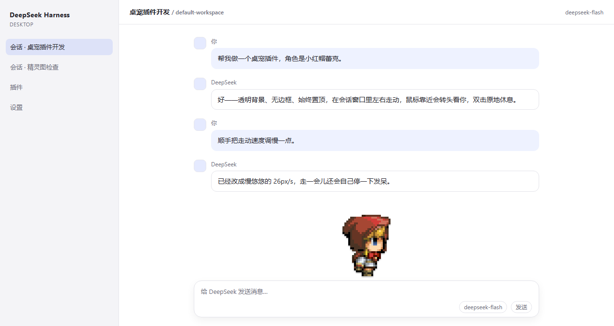
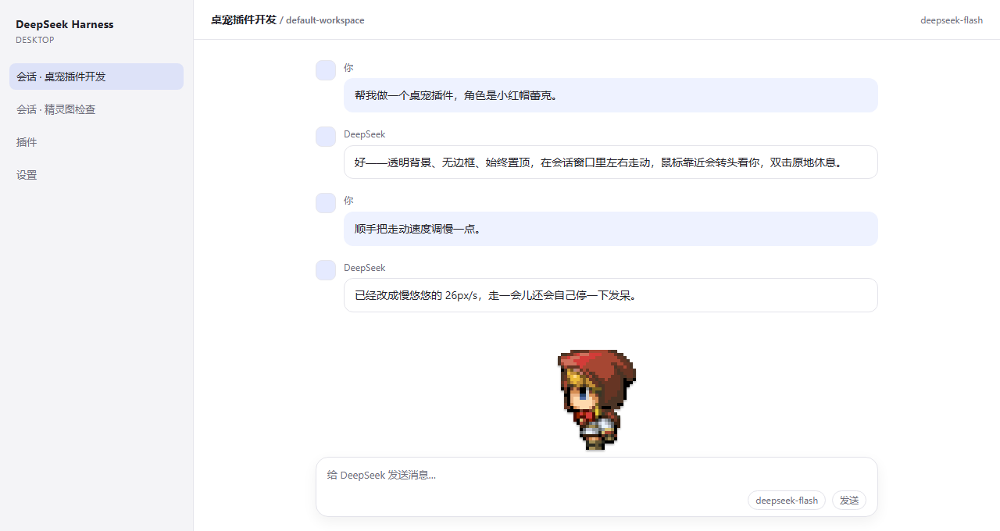
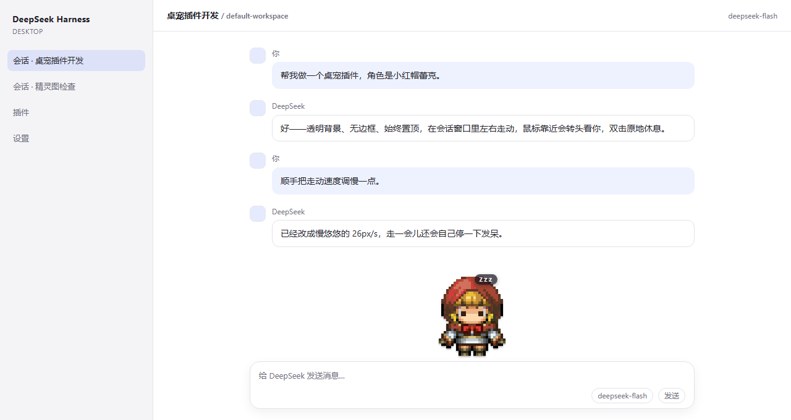
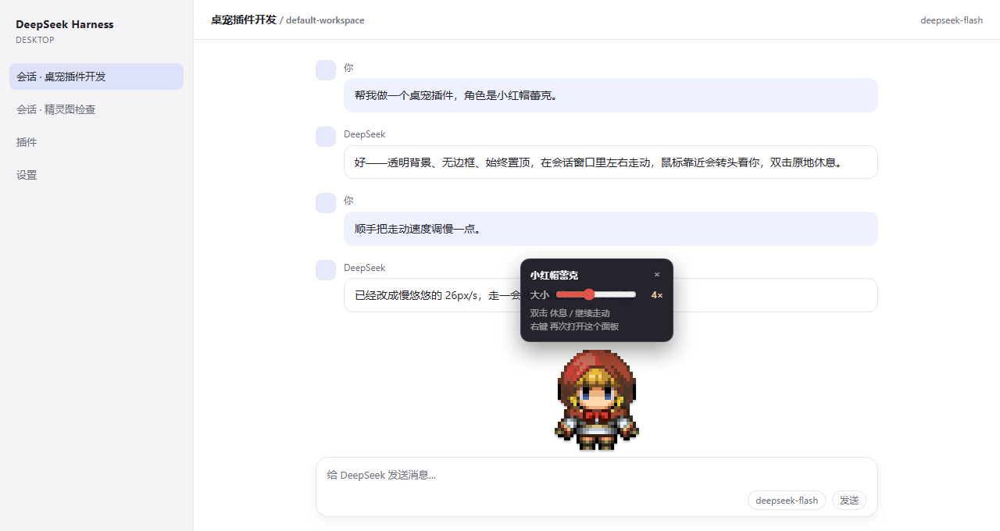

# dsh-leike-pet · 小红帽蕾克桌宠

给 DeepSeek Harness（DSH）会话窗口加一只像素桌宠：黑童话里的**小红帽蕾克**。
透明背景、无边框、始终置顶，平时在会话窗口底部左右慢悠悠地走动，偶尔停下张望、
蹦一下；鼠标靠近会停下并把头转向你；双击它原地睡着，再双击继续散步；
右键可以打开设置面板把大小调到 2×~7×。

A tiny pixel-art desktop pet for the DeepSeek Harness session window — transparent,
borderless, always on top; it strolls along the composer, blinks, looks around,
turns its head toward your cursor, sleeps on double-click, and scales 2×–7×.

| 走动 | 靠近你 | 睡觉 | 调大小 |
| --- | --- | --- | --- |
|  |  |  |  |

> 上面的截图来自仓库里的 `preview/index.html`（本地还原 DSH 布局的预览页），
> 用来展示实际渲染效果；插件跑在真实会话窗口里时外观一致。

## 功能

- **透明无边框、始终置顶**：覆盖层 `position:fixed`，只有精灵本体接收鼠标事件，
  不会挡住输入框或消息。
- **在会话窗口里散步**：用 DSH 会话容器的稳定属性
  （`[data-conversation-content]` / `[data-composer-seat]`）测出地面与左右边界，
  在输入框上沿来回走，速度 26px/s；走到边上会掉头，走一会儿随机停下待机。
- **会呼吸的小动作**：
  - 走动时两步一拍的上下起伏（整数像素，不糊边）；
  - 待机时左右张望、偶尔蹦一下；
  - 平时随机眨眼（单独的闭眼帧），睡觉时直接闭眼；
  - 走到边界掉头时先露一下背影，像真的转了个身。
- **鼠标靠近会看你**：鼠标进入头部 220px 半径时停下并切换三向姿势（左 / 正 / 右）；
  鼠标离开或停在原地超过 2.6 秒后继续走动。
- **双击睡觉**：闭眼 + 呼吸起伏 + 头顶 `Zzz`，再双击恢复走动。
- **右键调大小**：面板里 2×~7× 实时缩放，整数倍放大 + `image-rendering:pixelated`，
  任何尺寸像素都不会糊；选择记在 `localStorage`，下次打开还是这个大小。
- **不挑主题**：亮色 / 暗色主题都能看清；面板用深色半透明底，和精灵的像素风一致。

## 安装

### 从 npm（推荐）

```sh
dsh plugin --profile web add dsh-leike-pet
```

### 从 GitHub

```sh
dsh plugin --profile web add github:Zyr147258/dsh-leike-pet
```

### 官方桌面端（Electron 客户端，`desktop` profile）

桌面端 profile 由客户端独占管理，命令行不能直接改。在这个对话里让宿主自带的
`plugin_manager` 装即可：

```text
plugin_manager install_bundle  target: link:<本目录绝对路径>
```

或从 npm / GitHub 装同名包。**首次安装后要完全退出客户端（含托盘）再打开**：
桌面端只在宿主启动时收集一次 `index.html` 注入表，插件注册得再早，也要等下一次
启动才会被塞进页面。

### 本地开发

```sh
git clone https://github.com/Zyr147258/dsh-leike-pet.git
dsh plugin --profile web add link:$PWD
```

装完重启 `dsh web`，浏览器 `Ctrl+F5`。

## 使用

| 操作 | 效果 |
| --- | --- |
| 什么都不做 | 在会话窗口底部左右缓慢走动，偶尔停下张望 / 蹦一下 / 眨眼 |
| 鼠标靠近 | 停下，头转向鼠标方向；鼠标离开或停住不动约 2.6 秒后继续走 |
| 双击精灵 | 原地睡觉（闭眼 + Zzz），再双击继续走动 |
| 右键精灵 | 打开/关闭设置面板（大小 2×~7×） |
| Esc / 点面板外 | 关闭设置面板 |

想调整手感，改 `lib/pet.js` 顶部的常量（改完刷新页面即生效，不用重启宿主）：

```js
var SPEED = 26              // 走动速度 px/s
var ALERT_RADIUS = 220      // 鼠标靠近多少像素开始转头
var ALERT_HOLD_MS = 2600    // 鼠标停住多久后继续走动
var IDLE_MIN / IDLE_MAX     // 每次停下待机的时长
var WALK_BURST_MIN / MAX    // 连续走多久后随机停一下
var BLINK_MIN / BLINK_MAX   // 眨眼间隔
var LOOK_MIN / LOOK_MAX     // 待机张望间隔
var HOP_CHANCE              // 待机时蹦一下的概率
var SCALE_MIN / SCALE_MAX   // 面板里可调的大小范围（整数倍）
```

## 结构

```text
dsh-leike-pet/
├── package.json                # dsh.bundle.patch 指向 cordis.patch.yml
├── cordis.patch.yml            # 把 Host 半侧挂进 profile
├── icon.png                    # 插件列表图标
├── lib/
│   ├── index.js                # Host 半侧：/dsh-pet/* 静态资源 + index.html 注入
│   └── pet.js                  # 浏览器半侧：纯 DOM 桌宠（不依赖 React / 客户端插件运行时）
├── assets/
│   ├── frame-front.png         # 正面（待机 / 转头）
│   ├── frame-left.png          # 朝左（走动 / 转头）
│   ├── frame-right.png         # 朝右（left 的镜像）
│   ├── frame-back.png          # 背面（掉头过渡）
│   ├── frame-front-blink.png   # 正面眨眼
│   ├── frame-left-blink.png    # 朝左眨眼（右向由它镜像）
│   ├── frame-right-blink.png   # 朝右眨眼
│   ├── frame-front-sleep.png   # 睡觉（闭眼正面）
│   └── source-sheet.png        # 原始四格立绘
├── preview/index.html          # 本地预览 + 交互自测页（?selftest=1）
└── tools/build_sprites.py      # 从原始立绘重建透明底像素精灵 + 闭眼帧
```

## 精灵图是怎么来的

原始素材是一张 1040×320 的四格立绘（纯色背景）。`tools/build_sprites.py`：

1. 抠掉背景色 `#18141e`；
2. 按 7.25 倍的放大格反采样回 25~27 × 32 的原始像素网格；
3. 按「内容包围盒中心」对齐到共同画布（换姿势时头部不抖）；
4. 输出**原始像素尺寸**（27×32）的 RGBA PNG，前端按整数倍用 CSS 放大——
   这样 2×~7× 任意大小都是正方形的锐利色块，不需要多套图；
5. 闭眼帧：按列把虹膜/眼眶的黑蓝像素换成肤色，再在中间补 2px 的闭眼线；
   右向闭眼直接镜像左向。

想换成自己的角色，替换 `assets/frame-*.png`（保持 27×32 画布、透明底、脚底贴齐
画布下沿）即可。

## 调试

页面里的 `window.__DSH_PET__` 暴露了只读状态与几个手动接口：

```js
__DSH_PET__.state        // 'walk' | 'idle' | 'alert' | 'rest'
__DSH_PET__.pose         // 'front' | 'left' | 'right' | 'back' | 'sleep' | '*Blink'
__DSH_PET__.scale        // 当前大小倍数
__DSH_PET__.position     // { x, floor, minX, maxX, w, h }
__DSH_PET__.rest(true)   // 立刻睡觉
__DSH_PET__.setScale(6)  // 立刻放大到 6×
__DSH_PET__.openPanel()  // 打开设置面板
__DSH_PET__.face(x, y)   // 模拟鼠标位置（触发转头）
__DSH_PET__.step(16)     // 手动推进一帧（无 rAF 环境测试用）
__DSH_PET__.destroy()
```

## 和其它插件的兼容性

- **dsh-whale-widget（小鲸鱼）**：路由（`/dsh-pet/*` vs `/dsh-whale/*`）、全局变量
  （`__DSH_PET_*` vs `__dshWhale*`）、样式节点 id 都不同，两边往 `index.html` 推的注入行
  各自去重，可以同时存在。桌宠会读鲸鱼暴露的 `window.__dshWhaleRoot`，**自动让开它所在的
  角落**（右下角时散步范围在它左边 12px 停下），不会压住鲸鱼、也不会挡它的点击；鲸鱼的
  菜单/弹层 z-index 在 9999~26000+，鲸鱼 toast 在 2147483600，都仍在桌宠之上。
- **dsh-startup-screen（启动画面）**：桌宠 z-index 是 `2147482999`，比启动画面的
  `2147483000` 低一层，开场动画期间会被盖住，不会穿帮；动画结束后自然露出来。
- **dshmarket / 内置界面**：桌宠只加一个 `position:fixed`、`pointer-events:none` 的透明
  覆盖层，只有精灵本体和设置面板接收鼠标事件，不拦截任何界面点击。
- 不写配置文件、不注册 settings 命名空间、不碰宿主状态；唯一持久化的是
  `localStorage['dsh-pet:scale']`（大小偏好），卸载即干净。

## 已知边界

- 这是**应用窗口内**的桌宠，不是系统级桌面宠物（DSH 插件只能活在 Harness 的页面里）。
- 插件只提供静态资源，不读写任何凭据；走动位置等状态都在内存里，刷新即回到初始位置。
- 没有会话窗口时（例如停在设置页），会退化成沿主面板底部走动。

## License

MIT
